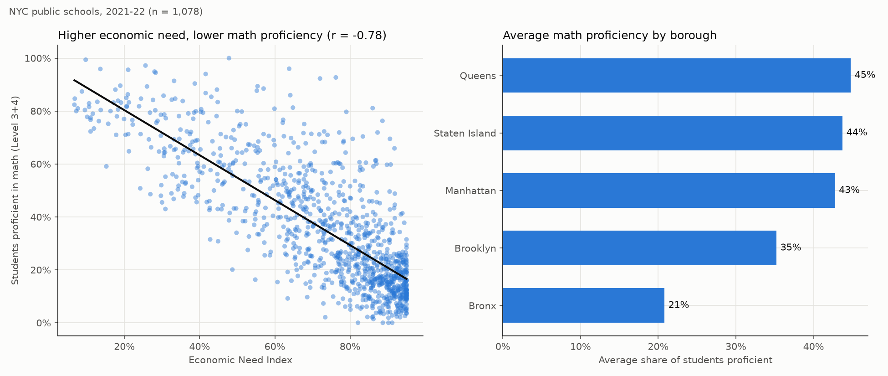
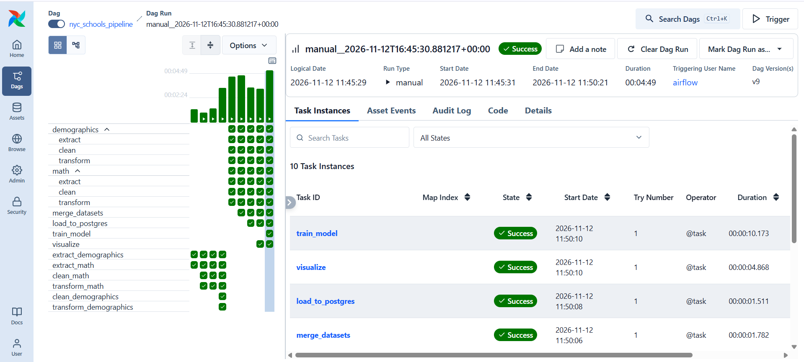
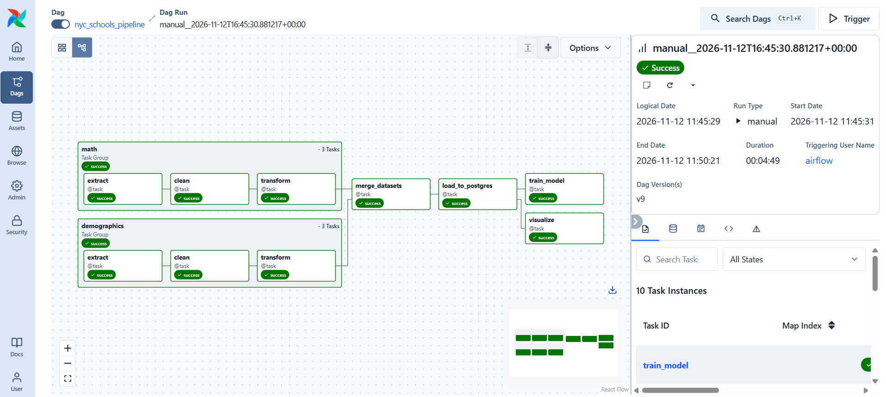
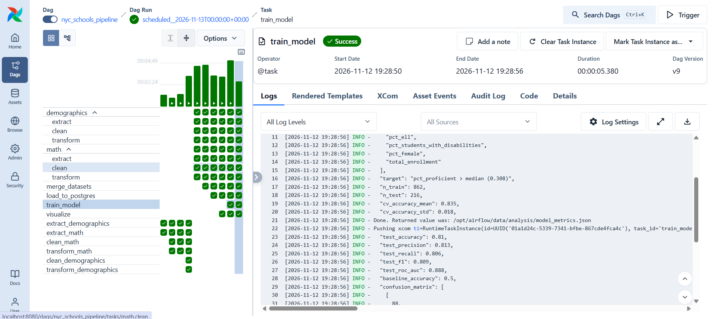
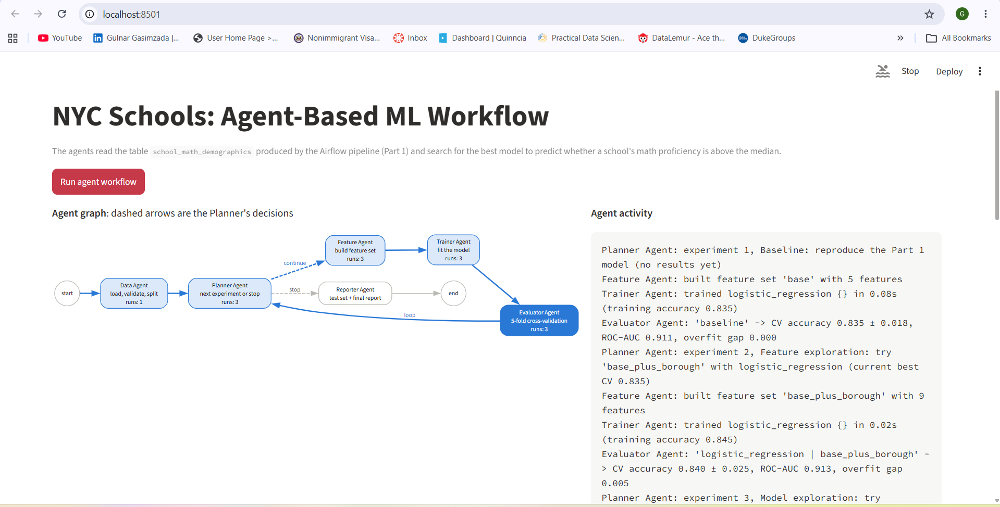
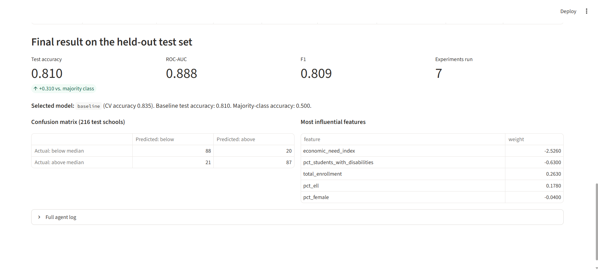
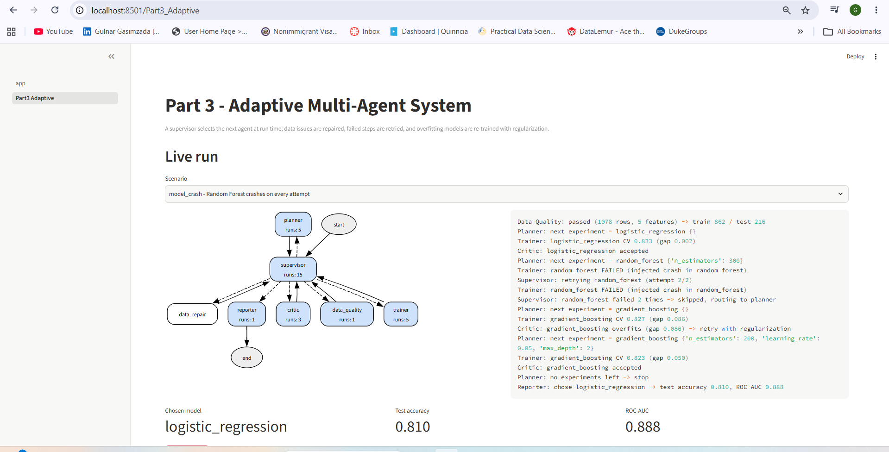
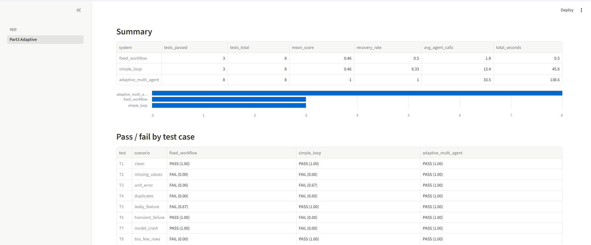

# NYC Schools: Airflow Data Pipeline, Agent-Based ML Workflow and Adaptive Multi-Agent System

An end-to-end project in three parts:

1. **Airflow pipeline (Part 1):** ingests two related NYC Open Data datasets, cleans and merges them, loads the result into PostgreSQL, and analyzes it with a chart and a baseline model.
2. **Agent workflow (Part 2):** a LangGraph agent graph reads the cleaned table from PostgreSQL and runs an experiment **loop** that trains, evaluates and compares models, shown live in a Streamlit UI.
3. **Adaptive multi-agent system (Part 3, bonus):** a supervisor-based LangGraph system that selects agents, routes tasks and retries failed steps at run time, with an evaluation suite that compares it against Parts 1 and 2.

**Question:** How is the economic profile of a NYC public school's student body related to its students' math results?

## Submission checklist

| Requirement | Where |
|---|---|
| Airflow DAG | [`dags/nyc_schools_pipeline.py`](dags/nyc_schools_pipeline.py) |
| Agent code | [`agents/`](agents/) (graph in [`agents/graph.py`](agents/graph.py), agents in [`agents/nodes.py`](agents/nodes.py) and [`agents/reporter.py`](agents/reporter.py)) |
| Instructions for running all workflows | [How to run](#how-to-run) |
| Containerized setup | [`docker-compose.yaml`](docker-compose.yaml), [`Dockerfile`](Dockerfile), [`agents/Dockerfile`](agents/Dockerfile), [`.devcontainer/devcontainer.json`](.devcontainer/devcontainer.json) |
| Screenshots: DAG execution, DAG graph, agent graph, model evaluation | [Screenshots](#screenshots) |
| Summary of pipeline, agent design and key findings | [Part 1](#part-1-airflow-data-pipeline), [Part 2](#part-2-agent-based-ml-workflow), [Key findings](#key-findings) |
| **Part 3:** adaptive multi-agent system and workflow graph | [`agents/adaptive/`](agents/adaptive/), [Part 3](#part-3-bonus-adaptive-multi-agent-system-with-evaluation) |
| **Part 3:** evaluation suite | [`agents/adaptive/evaluate.py`](agents/adaptive/evaluate.py), results in [`agents/results/part3_eval.json`](agents/results/part3_eval.json) |
| **Part 3:** dashboard | Streamlit page **Part3 Adaptive** ([`agents/pages/2_Part3_Adaptive.py`](agents/pages/2_Part3_Adaptive.py)) |
| **Part 3:** comparison with two baselines | [Results vs. baselines](#results-vs-baselines) |


## Repository structure

```
nyc-schools-pipeline/
├── .devcontainer/
│   └── devcontainer.json        # VS Code Dev Container
├── dags/
│   ├── nyc_schools_pipeline.py  # Main pipeline DAG
│   └── setup_check.py           # Setup test DAG
├── agents/                      # Part 2 and Part 3: agent workflows
│   ├── graph.py                 # LangGraph graph and loop
│   ├── nodes.py                 # Data, Planner, Feature, Trainer, Evaluator
│   ├── reporter.py              # Reporter Agent
│   ├── state.py                 # Shared state of the agents
│   ├── ml.py                    # Feature sets and models
│   ├── config.py                # Settings and search space
│   ├── db.py                    # Reads the table from PostgreSQL
│   ├── app.py                   # Live agent graph UI (Streamlit)
│   ├── run.py                   # Run the agents from the terminal
│   ├── adaptive/                # Part 3: adaptive multi-agent system
│   │   ├── scenarios.py         # 8 fault-injection scenarios
│   │   ├── modeling.py          # Shared split, models and metrics
│   │   ├── state.py             # Shared state of the graph
│   │   ├── agents.py            # Supervisor + 6 agents
│   │   ├── graph.py             # LangGraph wiring
│   │   ├── run.py               # Run one scenario from the terminal
│   │   ├── baselines.py         # Fixed workflow and simple loop baselines
│   │   └── evaluate.py          # Evaluation suite
│   ├── pages/
│   │   └── 2_Part3_Adaptive.py  # Part 3 dashboard page
│   ├── results/                 # report.json (Part 2), part3_eval.json (Part 3)
│   ├── Dockerfile
│   └── requirements.txt
├── screenshots/                 # Screenshots used in this README
├── docker-compose.yaml          # Airflow, PostgreSQL and agent services
├── Dockerfile                   # Custom Airflow image
├── requirements.txt             # Extra packages for Airflow
├── .env                         # Airflow user ID
├── .gitignore                   # Files not stored in Git
└── README.md
```

The `data/` folder is created by the pipeline at runtime and is not stored in the repository.

### Architecture

```
NYC Open Data ──► Airflow DAG ──► PostgreSQL ──► Agent workflow ──► Streamlit UI
  (2 CSVs)        (Part 1)       (schools-db)    (Part 2)          (live graph)
                                      │
                                      └────────► Adaptive multi-agent system + evaluation suite
                                                 (Part 3)          (dashboard page)
```

Airflow and the agents run in separate containers and share only the database table `school_math_demographics`.

---

## Part 1: Airflow Data Pipeline

### Data sources

| Dataset | Source | Raw size | Contents |
|---|---|---|---|
| [Math Test Results 2013-2023](https://data.cityofnewyork.us/d/74kb-55u9) | NYC Department of Education | 624,572 rows | NY State math exam results (grades 3-8) by school, grade, year and student group |
| [2017-18 to 2021-22 Demographic Snapshot](https://data.cityofnewyork.us/d/c7ru-d68s) | NYC Department of Education | 9,251 rows | Enrollment, English Language Learners, students with disabilities, poverty, Economic Need Index |

### Why these datasets

- **Meaningful question:** they connect learning outcomes with each school's economic and social context.
- **Shared key:** both identify schools by their **DBN** code (e.g. `01M015`), so they can be joined reliably.
- **Recent and aligned:** both cover the **2021-22 school year** (the spring 2022 exam matches the 2021-22 snapshot).
- **Automatable:** public CSV downloads with no API key.
- **Realistic cleaning work:** mixed reporting levels, suppressed values and inconsistent formats.
- **Suitable for ML:** the proficiency rate gives a clear classification target for the agent workflow.

### Pipeline structure

```
   TaskGroup: math                   TaskGroup: demographics
   extract -> clean -> transform     extract -> clean -> transform
                         \                 /
                          \               /
                           merge_datasets
                                 |
                          load_to_postgres
                             /        \
                       visualize    train_model
```

| Stage | Tasks | What happens |
|---|---|---|
| Ingest | `math.extract`, `demographics.extract` | Download each CSV from NYC Open Data |
| Clean | `math.clean`, `demographics.clean` | One row per school for 2021-22, fix types, handle suppressed and censored values |
| Transform | `math.transform`, `demographics.transform` | Standardize column names and units |
| Merge | `merge_datasets` | Inner join on `dbn` |
| Load | `load_to_postgres` | Write the table `school_math_demographics` to PostgreSQL |
| Analyze | `visualize`, `train_model` | Read from PostgreSQL, chart the data, train a baseline model |

### Transformations

- **Math results (624,572 rows -> 1,078 schools):** kept school-level rows for the 2022 exam, all grades and all students (1,121 schools); dropped 43 schools with suppressed results (`s`); renamed `Geographic Subdivision` to `dbn`; converted percentages to a 0-1 scale.
- **Demographics (9,251 rows -> 1,881 schools):** kept the 2021-22 year and 13 of 44 columns; converted text percentages (`"84.7%"`) to numbers; replaced censored `"Above 95%"` values with 0.95.
- **Merge and load:** inner join on `dbn` -> **1,078 schools, 17 columns, 100% of math schools matched**; loaded with `dbn` as the primary key.

### Challenges and how they were solved

| Challenge | Solution |
|---|---|
| The math dataset has **no `DBN` column** | Exploration showed the DBN is stored in `Geographic Subdivision`; renamed and verified (100% match) |
| One table mixes citywide, borough, district and school rows, 7 grades and 30+ student groups | Filtered to one row per school |
| School year written as `2022` vs `2021-22` | Mapped the spring 2022 exam to the 2021-22 school year |
| Suppressed results (`s`) | Dropped the 43 schools, because the proficiency rate is the ML target |
| Percentages in three formats, including censored `"Above 95%"` | Converted all to 0-1; replaced censored values (227) with their lower bound instead of dropping the highest-need schools |
| Charter schools planned as a feature, but none reported at school level for 2022 | Removed the feature and documented the finding |
| Temporary `HTTP 503` errors from NYC Open Data on the 61 MB download | Automatic retries (3 attempts, 1-minute delay) and downloads to a temporary file |
| Daily re-runs could duplicate rows | `TRUNCATE` + `COPY` in one transaction: always exactly 1,078 rows; a failed load rolls back |
| Bad data could pass silently | Quality checks stop the run on duplicates, out-of-range values, a low match rate or a row-count mismatch |

### Scheduling and parallel processing

- **Scheduling:** `@daily` (midnight UTC) with `catchup=False` and `max_active_runs=1`.
- **Parallel processing:** the **LocalExecutor** runs independent tasks at the same time. The `math` and `demographics` TaskGroups run in parallel (the demographics group finishes while the larger math file is still downloading), and `visualize` and `train_model` run in parallel after the load. `merge_datasets` waits for both groups.

### Analysis results (Part 1)

- **Strong negative relationship (r = -0.78)** between a school's Economic Need Index and its share of students proficient in math.
- **Borough averages:** Queens 45%, Staten Island 44%, Manhattan 43%, Brooklyn 35%, Bronx 21%.



*Figure 1. Each dot is a school: schools with a higher Economic Need Index have a lower share of students proficient in math (r = −0.78). Average proficiency by borough ranges from 21% in the Bronx to 45% in Queens.*

**Baseline model:** Logistic Regression predicting above-median proficiency (median 30.8%) from five features: Economic Need Index, % English Language Learners, % students with disabilities, % female, total enrollment. Poverty (duplicates the Economic Need Index), race/ethnicity shares (proxies for economic need, fairness concerns) and test-derived columns (data leakage) were excluded on purpose.

| Metric | Value |
|---|---|
| **Test accuracy** | **0.810** |
| Cross-validation accuracy (5-fold) | 0.835 ± 0.018 |
| ROC-AUC | 0.888 |
| Majority-class baseline | 0.500 |

---

## Part 2: Agent-Based ML Workflow

### Overview

The agents read the cleaned table produced by the Airflow pipeline and search for the best model for the same task as the Part 1 baseline. The workflow is built with **LangGraph**: each agent is a node, agents communicate through a shared state, and a **conditional edge** lets the Planner Agent loop back to run another experiment or stop. The graph and the loop were designed and written for this use case. The agents are rule-based (no LLM), so every run is reproducible, free and needs no API key.

### Agent graph

```
 start -> Data Agent -> Planner Agent --(stop)--> Reporter Agent -> end
                          ^      |
                     loop |      | (continue)
                          |      v
           Evaluator Agent <- Trainer Agent <- Feature Agent
```

| Agent | Role |
|---|---|
| **Data Agent** | Reads the table from PostgreSQL, checks it against a data contract (required columns, at least 500 rows, no missing values, unique `dbn`, valid range), creates the target and makes the same stratified 80/20 split as Part 1 |
| **Planner Agent** | Looks at all results so far and decides the next experiment or stops the loop, explaining every decision |
| **Feature Agent** | Builds the requested feature set from the training data |
| **Trainer Agent** | Creates and fits the requested model; records training accuracy |
| **Evaluator Agent** | Scores the experiment with 5-fold cross-validation on the **training data only** (accuracy, ROC-AUC, F1, overfitting gap) and adds it to the history |
| **Reporter Agent** | Retrains the selected model on all training data, evaluates it **once on the held-out test set** and writes `agents/results/report.json` |

### How the loop works

The Planner works in stages, and every stage builds on the best result so far:

1. **Baseline:** reproduce the Part 1 model.
2. **Feature exploration:** add borough (derived from the DBN, one-hot encoded) to the best model.
3. **Model exploration:** try Random Forest and Gradient Boosting on the best feature set.
4. **Tuning:** regularize every **promising** model family, i.e. one whose CV accuracy is within one standard deviation of the best. Families that overfit the most are tuned first.

**When does a model count as better?** Only if it beats the current best CV accuracy by at least **0.005**; smaller gains are within cross-validation noise (± 0.018), so the simpler model is kept.

**Stopping rules:** at most 12 experiments, stop after 6 experiments without a real improvement (patience), or when every planned experiment has been tried.

**Fair evaluation:** model selection uses cross-validation on the 862 training schools only. The 216 test schools are used once, by the Reporter, after the loop has finished.

### Live agent graph (Streamlit UI)

The UI at http://localhost:8501 runs the workflow and streams every agent step with LangGraph's `stream()`:
- the active agent is highlighted in the graph, agents show how many times they ran, and traversed edges are colored;
- the agent activity panel shows each agent's report, including the Planner's reasons;
- each experiment is added to a chart (CV accuracy ± one standard deviation, with the baseline as a reference line) and a table;
- the final test-set results appear when the Reporter finishes.

The graph is drawn from the compiled LangGraph structure, so it always matches `agents/graph.py`. A 0.4-second pause between agents is added only so the steps are visible; it does not affect the results.

### Results (Part 2)

| # | Model | Feature set | Parameters | CV accuracy | Overfitting gap |
|---|---|---|---|---|---|
| 1 | Logistic Regression | base | default | **0.835** ± 0.018 | 0.000 |
| 2 | Logistic Regression | base + borough | default | 0.840 ± 0.025 | 0.005 |
| 3 | Random Forest | base | default | 0.833 ± 0.014 | 0.167 |
| 4 | Gradient Boosting | base | default | 0.818 ± 0.017 | 0.095 |
| 5 | Random Forest | base | 300 trees, min_samples_leaf=5 | 0.831 ± 0.011 | 0.075 |
| 6 | Random Forest | base | 300 trees, max_depth=6 | 0.836 ± 0.010 | 0.059 |
| 7 | Gradient Boosting | base | 200 trees, lr=0.05, max_depth=2 | 0.829 ± 0.021 | 0.043 |

The Planner stopped after 7 experiments (6 without a gain of at least 0.005) and selected the **baseline Logistic Regression**.

**Final evaluation on the held-out test set (216 schools):**

| Metric | Value |
|---|---|
| **Test accuracy** | **0.810** (majority class: 0.500) |
| ROC-AUC | 0.888 |
| Precision / Recall / F1 | 0.813 / 0.806 / 0.809 |
| Confusion matrix | 88 TN, 20 FP, 21 FN, 87 TP |
| Strongest feature | Economic Need Index (coefficient -2.53) |

These numbers are identical to the Part 1 baseline, which confirms that the agents use the same data, split and model setup as the Airflow pipeline.

---

## Part 3 (Bonus): Adaptive Multi-Agent System with Evaluation

### Overview

A supervisor-based LangGraph system (`agents/adaptive/`). Instead of a fixed loop, a **supervisor** reads the shared state after every step and selects the next agent. The workflow therefore adapts at run time: it repairs bad data, retries failed steps, skips models that keep crashing, re-trains overfitting models with regularization, and stops safely when the data cannot be trusted. All agents are rule-based (no LLM), so every run is reproducible.

### Workflow graph

```
                 START
                   |
                   v
   +---------> SUPERVISOR ---------> reporter -> END
   |          (selects the next agent)
   |      +------+------+------+------+
   |      v      v      v      v      v
   |   data_  data_  planner trainer critic
   |   quality repair
   +------+------+------+------+------+   (every agent reports back)
```

| Agent | Responsibility | Adaptive behavior |
|---|---|---|
| **Supervisor** | Routes work based on the state | Selects agents, retries failed steps, skips crashing models, aborts on blocking issues |
| **Data Quality** | Checks row count, duplicates, missing values, ranges, leakage | Unrepairable issue -> abort; repairable -> Data Repair |
| **Data Repair** | Deduplicates, imputes, rescales 0-100 values, removes leaky features | Data is re-checked after every repair |
| **Planner** | Picks the next experiment (Logistic Regression, Random Forest, Gradient Boosting) | Excludes skipped model families |
| **Trainer** | Trains and cross-validates; catches errors | Errors are routed back to the supervisor for a retry |
| **Critic** | Reviews intermediate results | Overfitting -> re-queues the model with regularization; CV > 0.95 -> rejects (possible leakage) |
| **Reporter** | Evaluates the chosen model once on the test set | Writes a safe "aborted" report when no model can be trusted |

**Example (`model_crash` scenario):** Random Forest fails -> the supervisor retries it -> it fails again -> the supervisor skips it and routes to the planner -> Gradient Boosting overfits (gap 0.086) -> the critic re-queues it with regularization (gap 0.050) -> the reporter keeps Logistic Regression: **test accuracy 0.810, ROC-AUC 0.888**, identical to Parts 1 and 2.

### Evaluation suite

The suite ([`agents/adaptive/evaluate.py`](agents/adaptive/evaluate.py)) injects one realistic problem per test case into the clean table. Each test case specifies the input, expected behavior, scoring criteria and threshold. Score = share of checks passed; a test passes at score >= 1.0.

| Test | Input | Expected behavior | Scoring criteria |
|---|---|---|---|
| T1 | Clean table | Completes without repairs | completed, accuracy >= 0.78, no unnecessary repair |
| T2 | 5% of Economic Need Index missing | Imputes and completes | completed, repair performed, accuracy >= 0.75 |
| T3 | 3% of `pct_ell` on a 0-100 scale | Rescales and completes | completed, repair performed, accuracy >= 0.75 |
| T4 | 25 duplicate schools | Deduplicates and completes | completed, repair performed, accuracy >= 0.75 |
| T5 | Leaky feature requested (`mean_scale_score`) | Removes it, trains without it | completed, feature excluded, accuracy < 0.95 |
| T6 | First training call crashes | Retries and completes | completed, retry performed, accuracy >= 0.78 |
| T7 | Random Forest always crashes | Skips it, completes with another model | completed, accuracy >= 0.78 |
| T8 | Only 100 rows | Stops safely with a reason | aborted without a model, reason recorded |

Intermediate quality is measured by the data checks, repairs and CV / overfitting-gap reviews; final quality by test accuracy; coordination by agent calls, retries, recovery rate and run time.

### Results vs. baselines

All three systems receive exactly the same perturbed data:
- **Fixed workflow:** the Part 1 Airflow logic, with predefined steps, fail-fast checks, one model, and retries that repeat the same step.
- **Simple agentic loop:** the **real Part 2 LangGraph workflow** (`agents/graph.py`), run unchanged. During the evaluation only its data source (`load_table`) and model factory (`make_model`) are patched, so that the same scenarios and faults can be injected.

| Test | Fixed workflow | Simple agentic loop | Adaptive multi-agent |
|---|---|---|---|
| T1 clean | PASS | PASS | PASS |
| T2 missing values | FAIL | FAIL | PASS |
| T3 unit error | FAIL | FAIL (0.67) | PASS |
| T4 duplicates | FAIL | FAIL | PASS |
| T5 leaky feature | FAIL (0.67) | PASS | PASS |
| T6 transient failure | PASS | FAIL | PASS |
| T7 model crash | PASS | FAIL | PASS |
| T8 too few rows | FAIL | PASS | PASS |
| **Passed** | **3/8** | **3/8** | **8/8** |

| Coordination metric | Fixed workflow | Simple agentic loop | Adaptive multi-agent |
|---|---|---|---|
| Mean score | 0.46 | 0.46 | 1.00 |
| Recovery rate (6 fault scenarios that should complete) | 50% | 33% | 100% |
| Avg. steps / agent calls per run | 1.8 | 13.4 | 33.5 |
| Total evaluation time | 0.5 s | 45.6 s | 138.6 s |

Two results show that **a successful run is not the same as a trustworthy result**:
- **T3:** the Part 2 data contract only checks the range of the *target*, so the simple loop finishes but silently trains on 32 corrupted `pct_ell` values (score 0.67).
- **T5:** the fixed workflow finishes with realistic accuracy but silently trains on the leaky feature (score 0.67). The simple loop passes only because its feature sets are fixed in `config.py`.

### Summary

- **Fixed workflow:** fast and predictable, and Airflow retries handle transient errors. But every data problem stops the pipeline, and it cannot judge its own output: it trains on a leaky feature and on only 100 rows without complaint.
- **Simple agentic loop:** explores many models and its data contract refuses missing values, duplicates and too little data. But it cannot repair data, it misses corrupted feature values, and one crashing model stops the whole run.
- **Adaptive multi-agent system:** passes all 8 tests and recovers from every injected fault. The cost is coordination overhead: about 2.5x more agent calls than the simple loop and the longest run time, because every step goes through the supervisor and overfitting models are trained twice.
- On clean data all three systems reach the same accuracy. The value of the adaptive system is **robustness**, not a better model.


## Key findings

- **Economic need is the dominant signal.** Schools serving a higher share of students facing economic hardship have, on average, lower math proficiency (r = -0.78). The Economic Need Index is by far the strongest predictor in every model.
- **A simple model is enough.** Seven experiments across three model families and two feature sets all converged to **0.83-0.84 CV accuracy**. Regularization cut overfitting in Random Forest from 0.167 to 0.059 and improved Gradient Boosting by 1.1 points, but no model beat the baseline by more than the noise threshold. The limit comes from the data, not from the model.
- **Borough adds little.** Adding borough raised CV accuracy by only 0.005, within noise, likely because the Economic Need Index already captures most of the differences between boroughs.
- **The final model predicts above- or below-median math results for 81% of unseen schools**, 31 points better than guessing the majority class.
- **Robustness comes from coordination, not from a better model.** All three systems reach the same accuracy on clean data, but only the adaptive multi-agent system survives all injected faults (8/8 vs. 3/8 for both baselines), at the cost of more steps and a longer run time.
- **These are school-level associations.** They do not describe individual students and do not show that economic need causes lower results. Factors that are not in the data, such as school resources and teacher experience, may explain the remaining differences.

**Limitations:** one school year; school-level data only; the median threshold is a modeling choice; censored values were set to 95%; charter schools are not included. In Part 3, the Part 2 baseline is the real workflow, but the Part 1 baseline re-implements the Airflow DAG's checks and retries in Python (same split, models and metrics) instead of running the live DAG; the agents are rule-based, and the evaluation covers eight scenarios.

---

## How to run

Requires Docker Desktop. Ports used: `8080` (Airflow), `5433` (database), `8501` (agent UI).

```bash
docker compose build
docker compose up airflow-init
docker compose up -d
```

> **Note:** The `data/` folder is not committed. The DAG downloads both datasets from NYC Open Data on every run and recreates all intermediate files.

1. **Airflow pipeline (run first):** open http://localhost:8080 (`airflow` / `airflow`), unpause and trigger `nyc_schools_pipeline`. It loads the table `school_math_demographics` that the agents need.
2. **Agent workflow:** open http://localhost:8501 and click **Run agent workflow**, or run `docker compose exec agents python run.py`. The final report is saved to `agents/results/report.json`.
3. **Adaptive multi-agent system:** open the **Part3 Adaptive** page at http://localhost:8501 to run a scenario live and view the evaluation results, or use the terminal:

```bash
docker compose exec agents python -m adaptive.run model_crash   # one scenario
docker compose exec agents python -m adaptive.evaluate          # full evaluation suite
```

The evaluation results are saved to `agents/results/part3_eval.json`.

---

## Screenshots

### Part 1: Airflow pipeline

**Successful DAG execution in the Airflow UI**


**DAG graph view**


**Baseline model evaluation (`train_model` task)**


### Part 2: Agent workflow

**Live agent graph during a run**


**Final model evaluation on the held-out test set**


### Part 3: Adaptive multi-agent system

**Live adaptive workflow graph (`model_crash` scenario: retry, skip, regularization)**


**Evaluation suite: adaptive system vs. the two baselines**
